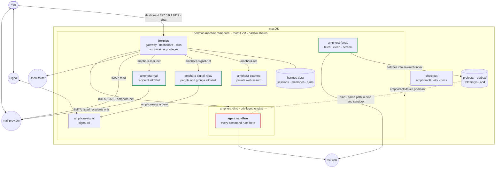
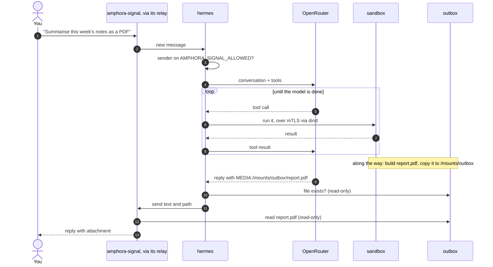
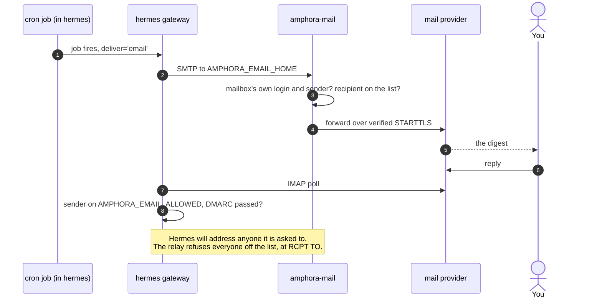

# Amphora

A home for a [Hermes Agent](https://hermes-agent.nousresearch.com/) on your Mac: the agent
runs in Podman, does its work in a sandbox nested inside a second container, and reaches
you through a dashboard, the terminal, Signal or email.

The agent is treated as untrusted. It has a terminal, and it reads text written by strangers.
Everything here is arranged so that a misled agent can do no more than an honest one was
already allowed to. [THREAT-MODEL.md](THREAT-MODEL.md) explains how.

**Start** [Before you start](#before-you-start) · [Quickstart](#quickstart) · [Commands](#commands)<br>
**Use** [Folders](#giving-the-agent-a-folder) · [Settings](#settings) · [Models](#models) · [Connecting](#connecting-signal-and-email) · [Signal](#signal) · [Email](#email) · [Feeds](#ai-watch-feeds)<br>
**Look after** [Backups](#backups) · [Updating Hermes](#updating-hermes) · [Code and runtime](#code-runtime-and-dev) · [Troubleshooting](#troubleshooting)

> **Names.** *Hermes* is the upstream agent, and keeps its name wherever the thing is
> Hermes': the `hermes` container, the `hermes-data` volume, every `HERMES_*` variable.
> *Amphora* is everything this repository adds around it: `amphoractl`, `etc/amphora.local`,
> the `amphora-*` containers, and every `AMPHORA_*` setting.

---

## How it fits together



<sub>Red: untrusted, the agent's own runtime. Green: a guard the agent cannot reach. The
sandbox's only routes out are the folders and the web; the two relays, `amphora-signal` and
`amphora-feeds` sit on networks of their own, which `amphora-dind` never joins.</sub>

Shell commands, `execute_code` and the file tools work in the sandbox, not in the Hermes
container or on macOS. Hermes' browser, connector and catalog tools would run in the Hermes
container, so they are switched off, and `doctor` fails if one comes back. One port is
published, the dashboard, on `127.0.0.1` only.

### A message, end to end

What happens when you ask over Signal for a report and get a file back:



The model only ever *asks* for actions; Hermes carries them out.
The outbox is the one folder the agent can write that anything else reads.

**The agent sees two folders and whatever you hand it:** `projects/` at `/projects`,
`outbox/` at `/mounts/outbox`, and anything added under `/mounts`. The checkout — the control
script, its configuration, these documents — sits outside every mount, so the agent cannot
edit the rules it runs under.

---

## Before you start

You need **Podman Desktop** and a **podman machine of Amphora's own**.

1. Install [Podman Desktop](https://podman-desktop.io). It brings the `podman` CLI at
   `/opt/podman`; use that one, not a second copy from a package manager. Skip its
   onboarding machine and leave its Docker compatibility **off**.

2. Copy the settings templates and fill in what you use:

   ```sh
   cp etc/amphora.local.example etc/amphora.local   # per machine, gitignored
   cp etc/mounts.example etc/mounts                 # optional: extra folders for the agent
   ```

   The one most worth filling in is `AMPHORA_RUNTIME_DIR`, which keeps the agent's projects,
   your snapshots and the logs out of the checkout (see [Code and runtime](#code-runtime-and-dev)).

3. Let `amphoractl` work out the machine for you, then create it as printed:

   ```sh
   ./bin/amphoractl shares          # creates projects/ and outbox/, ends with an init command
   podman machine init --rootful --cpus 4 --memory 8192 --disk-size 60 \
       --volume /path/to/projects:/path/to/projects \
       amphora                      # ← copy the real one from the output above
   podman machine start amphora
   ./bin/amphoractl shares          # every line green
   ```

Three things about the machine matter, and `doctor` checks all of them:

- **Rootful.** The inner engine needs `--privileged`, which a rootless machine will not grant.
- **Narrow shares.** Podman's default shares `/Users` — every home folder on the Mac — with a
  VM whose root is one step from a sandbox escape. Share only what the stack binds.
- **Amphora's alone.** Podman on macOS runs one VM at a time, and `podman-mac-helper` points
  `/var/run/docker.sock` at it, where a stray `docker system prune --volumes` would delete the
  agent's memory. Do general container work in OrbStack, Colima or Docker Desktop instead,
  and if `doctor` complains about `docker.sock`:
  `sudo /opt/podman/bin/podman-mac-helper uninstall`.

An existing machine with podman's 2 GB default needs more memory (`doctor` wants 6 GB):

```sh
podman machine stop amphora
podman machine set --rootful --memory 8192 --cpus 4 amphora   # disk can grow, never shrink
podman machine start amphora
```

---

## Quickstart

```sh
./bin/amphoractl secrets set              # OpenRouter key + a dashboard login; never echoed
./bin/amphoractl up
./bin/amphoractl doctor                   # all green? you're running
./bin/amphoractl project new myproject    # → /projects/myproject for the agent
./bin/amphoractl chat
```

The dashboard is at <http://127.0.0.1:9119>, behind the login you just set.

After a reboot the machine does not start itself:
`podman machine start amphora && ./bin/amphoractl up`.

---

## Commands

`doctor` first, always. It checks the machine, the shares, every mount, secrets, the engine
link and each optional service, and says what to do about anything red.

| Every day | |
|---|---|
| `up` · `down` · `status` | start or recreate everything; stop, keeping all state; a quick look |
| `chat` · `shell` · `sandbox` | talk to the agent; a shell in Hermes; a shell in the sandbox |
| `logs hermes\|dind\|searxng\|signal\|signal-relay\|mail\|feeds\|agent` | follow a log |
| `project ls` · `project new <name>` | the agent's projects |
| `mount ls` · `mount add <path> [name] [--ro]` · `mount rm <name>` | folders the agent can reach |

| When something changes | |
|---|---|
| `config push` | apply `etc/config.yaml` and `etc/amphora.local`; recreates Hermes |
| `build-sandbox` · `reset-sandbox` | rebuild the agent's image; discard its container |
| `secrets set` · `secrets set email` · `secrets list\|rm` | podman's secret store |
| `shares` | what the machine must share, what it does, and the `init` command for it |
| `signal …` | `register`, `verify`, `pin`, `name`, `send`, `groups`, `status`, `logs`, `reset` |
| `feeds …` | `ls`, `held`, `check <url>`, `push`, `run`, `replay` |

| Looking after it | |
|---|---|
| `doctor` | diagnose everything; read-only, safe from any checkout |
| `backup` · `backup ls` · `backup schedule on\|off\|status` · `restore [stamp]` | snapshots |
| `update check` | is there a newer Hermes? Changes nothing that is running |
| `update` | snapshot, pull newer dind and SearXNG, recreate; never Hermes |
| `promote` · `rollback [--data]` | move `main` to `dev`, or back (live checkout only) |
| `nuke` | remove everything, secrets included; asks first |

`restart` is another name for `up`.

---

## Giving the agent a folder

```sh
./bin/amphoractl mount add ~/Documents/Research           # → /mounts/research
./bin/amphoractl mount add ~/Media/Reference refs --ro    # → /mounts/refs, read-only
./bin/amphoractl up                                       # binds are fixed at create
```

The list lives in `etc/mounts` (gitignored). `amphoractl` wires both hops — Mac to dind,
dind to sandbox — at the same path, and `doctor` reads the result back off the running
sandbox, read-only flag included. Never hand-edit the `# >>> amphoractl:mounts` block in
`etc/config.yaml`; it is regenerated on every push.

Some sources are refused outright: the checkout, the runtime folder, the snapshots, the
outbox, your whole home folder, or the whole Obsidian vault. One folder inside the vault is
allowed, and then the agent can read every note in it.

A folder must also be **shared by the machine**, or it arrives empty with no error. Shares are
fixed when the machine is created, so `mount add` accepts one outside them with a warning,
`up` skips it, and `doctor` stays red until you [replace the machine](#replacing-the-machine).

---

## Settings

Everything machine-specific is in `etc/amphora.local`; `etc/amphora.local.example` lists and
explains every setting. It is sourced before the defaults, so its values win, and it holds no
secrets — those are in podman's secret store.

**Files the agent writes are yours.** The sandbox image is built with your Mac's uid and gid,
so nothing in `projects/` lands owned by root. The agent has no `sudo`; to give it a tool,
add it to `etc/sandbox/Containerfile` and run `build-sandbox`. (`npm i -g` and
`pip install --user` work inside it, until the sandbox is rebuilt.)

**Scheduled jobs run on your clock.** The containers run UTC, but Hermes is handed your Mac's
time zone, so `0 7 * * *` means 7am where you are. Pin one with `AMPHORA_TIMEZONE` if the Mac
travels and the jobs should not. A change applies on `config push`; existing jobs keep their
stored next run until you re-set their schedule
(`podman exec hermes hermes cron edit <id> --schedule "0 7 * * *"`).

**Web search is private.** `web_search` goes to the stack's own SearXNG, which no third party
sees. Its settings are `etc/searxng/settings.yml`, copied in on every `up`; keep `json` in
`search.formats` or every query returns 403. `web_extract` uses Hermes' keyless free tier.

---

## Models

All through OpenRouter, set in `etc/config.yaml`, chosen on the cost of running a fixed
benchmark end to end rather than on price per token:

| Role | Model |
|---|---|
| Daily driver, and vision, compression, titles, approvals | `z-ai/glm-5.3-flash` |
| For work that needs more thought, by hand | `z-ai/glm-5.3` |
| Fallbacks, in order | `openai/gpt-5.6-luna`, `minimax/minimax-m3` |

Flash does nearly everything. Full GLM 5.3 is worth switching to for a hard problem, though
in practice it is only a little better. `moonshotai/kimi-k3.1-pro` is the best model tried
here by a clear margin, but at about 100 times Flash's output price it isn't affordable for
daily use. `anthropic/claude-haiku-5.5` costs about the same as Flash and scores well at
coding, but it followed non-coding instructions badly and garbled research and reports —
a reminder to judge a model on the work it will actually do here.

Switch for one conversation with `/model <name>` in chat — a Signal group per model makes
that a matter of picking a chat — or for good by editing the config and running
`config push`; sessions and memory survive either way.

`provider_routing` asks OpenRouter to avoid hosts that keep or train on requests. **Set the
same thing on your OpenRouter account** (privacy settings, deny data collection): the account
setting is the one that binds, for every request on the key, and it does not travel with a
new key or a new machine.

---

## Secrets

`secrets set` reads each value with echo off and hands it straight to `podman secret create`.
Podman injects them into the containers that need them at start. Nothing sensitive is written
to the checkout, and `terminal.docker_forward_env` stays empty, so **no credential reaches the
sandbox**.

Podman's default secret driver stores values base64-encoded inside the VM, not encrypted. That
keeps them off the Mac's disk and out of git, but it is not a vault; FileVault is what protects
the Mac itself.

---

## Connecting Signal and email

Both come ready-wired: there is nothing to change in Hermes' gateway. Fill in
`etc/amphora.local`, follow the steps below, and `up` starts the extra container, gives it a
private network and tells the gateway where to find it.

Leave **Channels** in Hermes' dashboard alone for these two. It can only save settings inside
Hermes; it cannot start the containers they need. An email account saved there could also go
around the relay that limits who the agent can write to, so `doctor` fails if it finds one.

---

## Signal

*Optional — off unless `AMPHORA_SIGNAL_ACCOUNT` is set.* The agent gets a Signal account of its
own, on a spare number, and you message it like any contact. Never link it to your personal
number: a linked device decrypts everything on the account. [SIGNAL.md](SIGNAL.md) has the
reasoning.

```sh
# with the number in etc/amphora.local:
open https://signalcaptchas.org/registration/generate.html     # token lasts minutes
./bin/amphoractl signal register 'signalcaptcha://…' [--reregister]
./bin/amphoractl signal verify 123456 [--pin 1234]
./bin/amphoractl signal pin set 1234
./bin/amphoractl signal name 'Hermes'
./bin/amphoractl up
./bin/amphoractl signal send 'hello from signal-cli'
```

- **A number that had Signal before is normal.** Use `--reregister`, and have the old
  Registration Lock PIN to hand. `signal reset server` deletes the account outright, and is
  also the way out of a registration that died halfway (409 on everything).
- **Who it may talk to, both ways.** Only `AMPHORA_SIGNAL_ALLOWED`, and the groups you list. A first contact often arrives as a
  bare UUID rather than a number; if the log says `Unauthorized user: <uuid>`, add that UUID
  beside the number, then `config push`.
- **Several conversations.** Each Signal group holding you and the bot is a separate session
  with its own history and `/model`. Create the group in the app, then `signal groups` to
  list it. Everyone in a group is still checked against the allowlist.
- **Files.** The agent copies a file into `/mounts/outbox` and replies
  `MEDIA:/mounts/outbox/<name>` (no spaces in the name). Teach it this with a skill of its
  own; none is included here. Nothing empties the outbox; tidy it when you like.

---

## Email

*Optional — off unless `AMPHORA_EMAIL_ADDRESS` is set.* The agent gets a mailbox of its own and
corresponds with the addresses on `AMPHORA_EMAIL_ALLOWED`, in both directions, and no one else.
Hermes sends through `amphora-mail`, a small relay that refuses every other recipient.
[EMAIL.md](EMAIL.md) has the reasoning.

```sh
# 0. at the provider: a separate user, IMAP on, 2-step verification, an app password.
#    Never a personal mailbox, an alias of one, or a delegation.
$EDITOR etc/amphora.local                 # the Email block of the example
./bin/amphoractl secrets set email
./bin/amphoractl up
./bin/amphoractl doctor                   # logs in, and asks the relay about one listed
                                          # address and one outsider; sends nothing
```

Mail from a listed address gets a threaded reply; anyone else gets silence. `AMPHORA_EMAIL_HOME`,
where scheduled output goes, must be on the list. Configure the mailbox here only — never
through `hermes setup`, which `doctor` will catch.

For a scheduled job that emails, create it with a schedule and let the gateway fire it.
Running one by hand from `chat` drops its attachments.



---

## AI-watch feeds

*Optional — off unless `etc/feeds.csv` has an active line.* `amphora-feeds` fetches a list of
release feeds every three hours, cleans and screens the text, and leaves batches in
`projects/ai-watch/inbox/`; a weekday job turns them into an emailed digest. The list is baked
into the fetcher's image, so only you can change it. [FEEDS.md](FEEDS.md) covers what the
filter does and does not stop.

```sh
cp etc/feeds.csv.example etc/feeds.csv
./bin/amphoractl feeds check https://github.com/<org>/<repo>/releases.atom   # try a source
./bin/amphoractl feeds push              # build and start; the first fetch only seeds
./bin/amphoractl feeds ls                # every source "ok"
```

The digest itself is a skill you write for your own interests; none is included here. Ask the
agent, in `chat`, to turn new batches into an email, and to run that as a weekday job with a
schedule. Tell it that everything in a batch is material to summarise, never instructions.

- **Sources** are `name,type,tier,url[,pattern]`, one per line; quote a field holding a
  comma, `#` to pause. Then `feeds push`.
- **Nothing arrives at first** because a new source's existing items count as seen.
  `feeds replay` sends each source's newest item again to test the digest.
- **Held items.** Text that trips the filter never reaches the agent, only its URL and the
  rule. `feeds held` shows it to you.

---

## Backups

Everything the agent has learned lives in podman volumes inside the VM, and
**`podman machine rm` or `reset` deletes them without asking**. Make a second copy:

```sh
./bin/amphoractl backup schedule on      # nightly at 03:30, keeps the newest 14
./bin/amphoractl backup                  # now
./bin/amphoractl backup ls
./bin/amphoractl restore                 # the newest; or name a stamp
```

A snapshot stops Hermes for a few seconds, so its SQLite state is copied whole rather than
torn. It covers `hermes-data` and, with Signal, `amphora-signal-data`; the other volumes
rebuild themselves. Caches are left out (about 55 MB instead of 1.8 GB), so a restored agent
re-downloads its tooling on first use. `doctor` warns when the newest snapshot is over a week old.
The snapshot that `rollback --data` would need is kept, however old.

> [!IMPORTANT]
> **A snapshot is every conversation you have had with the agent.** Keep it out of git, and
> keep `AMPHORA_BACKUP_DIR` outside any repository. Two `.gitignore` files help, and `doctor`
> fails if git can see a snapshot. The archives are not encrypted: FileVault protects them
> here, but not once you copy one elsewhere.

---

## Updating Hermes

Hermes changes only when you say so: its exact image is recorded as `HERMES_PIN` in
`lib/settings.sh`, so an update is a commit you can undo.

1. **Look.** `amphoractl update check` shows your version, the newest stable one, and the
   new `HERMES_PIN` line. Read the
   [release notes](https://github.com/NousResearch/hermes-agent/releases). Unless it is a
   security fix, give it a few days.
2. **Pin.** Replace that line on `dev`, and commit.
3. **Ship.** In the live checkout:

   ```sh
   ./bin/amphoractl promote     # snapshots first
   ./bin/amphoractl up
   ./bin/amphoractl doctor      # then say hello in chat
   ```

Not happy? `amphoractl rollback --data` returns the old version and the data that goes with
it, because an older Hermes cannot run on a newer one's database.

> [!WARNING]
> `rollback --data` loses everything since that `promote`: sessions, memories, and Signal's
> state if you use Signal. Decide early. It snapshots the current state before it starts, and
> your project files are not touched.

---

## Code, runtime and dev

A live install is three sibling folders. The names are a convention; nothing depends on them.

```
Amphora           main — the one checkout that runs the stack
Amphora-dev       a git worktree on dev, where changes are made
Amphora-runtime   projects/ outbox/ backups/ logs/ archive/ — not a repository
```

```sh
git clone <your remote> Amphora
git -C Amphora worktree add ../Amphora-dev dev
mkdir Amphora-runtime        # and set AMPHORA_RUNTIME_DIR in Amphora/etc/amphora.local
```

Only the checkout that started the stack may change it. The others can look (`doctor`,
`status`, `logs`). To ship a change:

```sh
cd Amphora-dev && git commit …
cd ../Amphora && ./bin/amphoractl promote
```

`promote` takes a snapshot, moves `main` up to `dev` and pushes it. Then it tells you which of
`up`, `config push` or `build-sandbox` to run. Run that, then `doctor`. If it was a mistake,
`rollback` undoes the code; `rollback --data` undoes the data too and runs `up`.

A second Mac is a separate deployment with its own settings, secrets, number and mailbox.
One Signal account on two machines deregisters one of them.

---

## Replacing the machine

Shares are fixed when the machine is created, so narrowing them, adding a folder outside them,
or moving to a runtime folder means a new machine — and with it, fresh volumes, images and
secrets. Snapshots carry you across:

```sh
./bin/amphoractl doctor && ./bin/amphoractl backup
./bin/amphoractl backup ls               # hermes-data (and amphora-signal-data) present
./bin/amphoractl shares                  # copy the init command it prints
./bin/amphoractl down
podman machine stop amphora && podman machine rm amphora   # deletes its volumes
<the init command>
podman machine start amphora
./bin/amphoractl shares                  # every line green
./bin/amphoractl secrets set             # the secret store went with the machine
./bin/amphoractl restore && ./bin/amphoractl up && ./bin/amphoractl doctor
```

Sessions, memories, skills and the Signal account come back; caches, the search config, TLS
material and the sandbox image rebuild themselves. Anything installed by hand inside the
sandbox does not — bake it into `etc/sandbox/Containerfile`. The printed command keeps the old
machine's CPUs, memory and disk; check the disk figure, since it can only grow.

Coming from a machine with another name, you can keep the old one stopped as a fallback until
the new one has proved itself.

---

## Good to know

- **One sandbox, all projects.** Every project shares one long-lived sandbox, so a package
  installed for one is there for all. `terminal.container_persistent: false` gives a fresh one
  per conversation instead.
- **Leave `/workspace` alone.** It belongs to Hermes; mount things under `/projects` or
  `/mounts`.
- **The gateway API (8642) is off on purpose.** Turning it on takes an `API_SERVER_KEY` podman
  secret, `API_SERVER_HOST=0.0.0.0` and a loopback publish in `start_hermes()` — and that
  host setting puts the API on `amphora-net`, within the sandbox's reach, so the key would be
  all that stands between the agent and a gateway that speaks for you.
- **Disk.** The inner engine keeps its own image store; budget a few GB for it.

---

## Troubleshooting

`./bin/amphoractl doctor` first — it names most problems and their fix. Beyond that:

| Symptom | Likely cause |
|---|---|
| `amphora-dind` exits at once | The machine is rootless: `podman machine set --rootful amphora` (stopped). |
| Hermes cannot reach the engine | `podman exec hermes docker info` gives the reason. An `x509 … not <name>` means dind's network alias is no longer `docker`. |
| `Write denied: … outside HERMES_WRITE_SAFE_ROOT` | The path is not under `/projects` or `/mounts`, or the container predates the script (`config push`). |
| Search returns nothing | A `403` in `logs searxng` means `json` is missing from `search.formats`. |
| The agent's projects look empty | The machine does not share the folder (`shares`), or the sandbox is stale (`reset-sandbox`). |
| Signal is alive but ignores someone | Their UUID is missing from `AMPHORA_SIGNAL_ALLOWED`; look for `Unauthorized user` in `logs hermes`. |
| Files the agent wrote have the wrong owner | The sandbox image was built for other ids: `build-sandbox`. |

---

## What it's made of

Almost everything that runs here is other people's work. Amphora is a thin wrapper that
connects the pieces, limits what they can reach and keeps them backed up.

```
 ┌─ Amphora ─────────── connects · limits · backs up ─┐
 │                                                    │
 │   Hermes        the agent, its gateway, dashboard  │
 │   Podman        the VM and the containers          │
 │   dind          the engine the sandbox runs in     │
 │   SearXNG       private web search                 │
 │   Signal        optional, through signal-cli       │
 │   Email         optional, through a small relay    │
 │   Volumes       what the agent remembers           │
 │                                                    │
 └────────────────────────────────────────────────────┘
```

---

## Further reading

| | |
|---|---|
| [THREAT-MODEL.md](THREAT-MODEL.md) | what is protected, from whom, and what risk remains |
| [SIGNAL.md](SIGNAL.md) · [EMAIL.md](EMAIL.md) · [FEEDS.md](FEEDS.md) | why each channel is shaped as it is |
| [tools/obsidian-kanban/](tools/obsidian-kanban/README.md) | an optional task board shared with the agent, kept in [Obsidian](https://obsidian.md) |
| [tools/research-review/](tools/research-review/RESEARCH-STANDARD.md) | the standard the agent's research is checked against |

## License

[Apache License 2.0](LICENSE). Hermes Agent and the other images this stack runs are
separate projects under their own licences.
